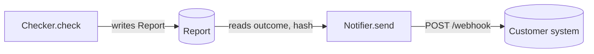

# Raise a PR

A reviewer should understand what a PR does and why from its first line, see how the parts interact without reading the diff, and see every important choice with the options that were turned down. The diff already lists the files; the description explains the change.

## Before you open it

- One logical change per PR. If the top line needs "and", split it. Branch each PR from main; don't stack PRs on each other. Land small shared changes first, and check open branches before removing code they may use.
- CI checks pass locally, run by you in this thread before every push, and you have evidence the change works.
- For TypeScript changes, review placement against the `module-structure` skill: one action per file, composition-only factories, pure domain rules, and I/O in adapters. Explain any deviation in the PR.
- Title: an imperative summary, prefixed with the work-item ID when the project uses them: `[A2] Sign reports with Ed25519`. Label `contract` if it touches the contract package.
- Open it ready for review, never as a draft. Merge only by the project's merge rule (`AGENTS.md`).

## The description

Use `.github/pull_request_template.md`. Sections in this order. Leave out a section only when it truly has nothing to say; never leave out the top line or Verification.

### 1. The top line

The first line of the body, before any heading: one sentence saying what this PR makes possible or changes, in terms of behavior, and why it matters. Keep it sharp and concise. Below it, `Closes #<issue>` when the PR finishes a work item, or `Refs #<issue>` when it only contributes to one.

- Describe the change logically, not as an inventory. Never list files, paths, packages or a feature-by-feature rundown. The diff shows those.
- Name a symbol only when it *is* the change (a renamed interface, a new event).

| ❌ Don't | ✅ Do |
| --- | --- |
| Adds `reports/src/sign.ts`, `canonical.ts`, `keys.ts`, updates `index.ts` and tests, and adds a script. | Reports are now signed, so anyone with our public key can check one without our database. |
| This PR implements several features for the importer including min rows, date range and refactoring. | The importer now rejects stale files, so a 2019 export no longer overwrites this year's data. |

### 2. Why

One to three sentences: the problem and the approach. No commit history, no "as discussed".

### 3. How it works (diagram)

Add a simple diagram when the PR involves a complex interaction between data models, or crosses a boundary: between teams' code, between the system and an outside service, or a change to a lifecycle or state machine. Skip it for changes that stay inside one module.

Use a Mermaid block (GitHub renders it in PR descriptions). Keep it small: about 8 nodes or fewer, only the parts this PR touches, and a label on every arrow saying what moves (`writes Report`, `POST /check`, `reads payload.outcome`). Mark what this PR adds or changes. Explain it in one sentence under the diagram.

````markdown

````

For a state machine change, draw the states and moves that change (`stateDiagram-v2`), not the whole machine.

### 4. Decisions and trade-offs

**Always** include this section when the PR makes a critical technical decision: a new library or service, a data shape other code will depend on, anything in the shared contract, a security or money-handling choice, or anything hard to reverse. Put it in a table:

| Option | Trade-offs | Chosen? |
| --- | --- | --- |
| Ed25519 | Small deterministic signatures, standard for documents | ✅ Smallest and simplest to verify anywhere |
| secp256k1 | Matches most crypto wallets; signatures aren't deterministic without extra care | ❌ Wallet match doesn't matter for reports |

- List every option you seriously considered, including "do nothing" when it was viable.
- The last column says why the chosen option won, or why each other option lost.
- If the choice needs a human (it reverses a decision already made, or the agents disagree), say so here and add the `needs-human` label.

### 5. Scope

What the PR covers and what it deliberately leaves out (follow-ups, known gaps). One to three short items.

### 6. Blast radius

One or two sentences: who or what this touches, and why that's safe or risky.

### 7. Verification

Evidence, not "it compiles": each command you ran and the key line it printed. For behavior a caller sees, run it end to end and say what you observed. If a check couldn't run, write "inconclusive" and why.

## Writing rules

- Short sentences. Active voice. Plain words.
- Headings (`##`), not bold lead-ins, so sections stand apart.
- No file-by-file lists, commit lists or changelog-style "also updated X" lines.
- Under a minute to read, excluding the diagram and table. If it's longer, cut words or split the PR.

## After opening

Post the link where the team discusses work if another owner's code is affected. When a review bot or a person comments, follow the `address-review` skill. After each merge, merge `main` into your other open PRs.
