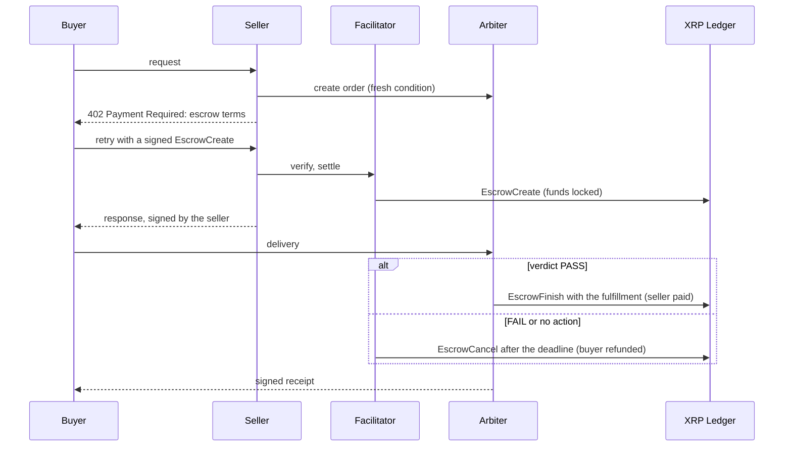

# x402-auth-capture-xrpl

The XRP Ledger binding of the x402 [`auth-capture`](https://github.com/x402-foundation/x402/blob/main/specs/schemes/auth-capture/scheme_auth_capture.md) payment scheme: **verify-then-pay for HTTP APIs and AI agents.**

A buyer's payment is locked in a native XRPL escrow before the seller responds. An independent verifier (the *arbiter*) checks what was delivered and releases the escrow to the seller only if it passes. If it fails, or nobody acts, the escrow expires and the funds can only return to the buyer. No smart contract is deployed: XRPL consensus enforces every rule.

> **Status: pre-release.** Testnet only, not audited, not yet published to npm. The binding spec is a draft that hasn't been proposed to [x402-foundation/x402](https://github.com/x402-foundation/x402) yet. Interfaces may change.

## Contents

- [Why](#why)
- [How it works](#how-it-works)
- [What this repository provides](#what-this-repository-provides)
- [Installation](#installation)
- [Usage](#usage)
- [HTTP interfaces](#http-interfaces)
- [Security model](#security-model)
- [Scope and limitations](#scope-and-limitations)
- [Repository layout](#repository-layout)
- [Development](#development)
- [Contributing](#contributing)
- [License and acknowledgments](#license-and-acknowledgments)

## Why

x402's `exact` scheme is pay-first: any successful response settles the payment before the buyer can inspect it, and there is no refund operation. For an AI agent buying data, a 200 response with an empty, stale or malformed body costs the same as a correct one, and there is nobody to dispute it with.

`auth-capture` separates *holding* a payment from *releasing* it. This binding implements that on the XRP Ledger using native escrow with a crypto-condition, so the release decision can belong to a verifier rather than to the seller.

## How it works



| `auth-capture` operation | XRPL mechanism | Performed by |
| --- | --- | --- |
| `authorize` | `EscrowCreate` with a PREIMAGE-SHA-256 `Condition` and `CancelAfter`, presigned by the buyer | Facilitator (relays the buyer's signed transaction) |
| `capture` | `EscrowFinish` with the `Fulfillment`, before `CancelAfter`, full amount | Arbiter (holder of the preimage), directly or through the facilitator |
| `reclaim` | `EscrowCancel` after `CancelAfter`; funds can only return to the buyer | Anyone; the facilitator's watcher does it automatically |
| `void`, partial capture, `refund`, `charge` | Not supported (see [limitations](#scope-and-limitations)) | — |

The full wire format, verification rules and settlement procedure are in the binding specification: [`specs/scheme_auth_capture_xrpl.md`](./specs/scheme_auth_capture_xrpl.md).

## What this repository provides

| Component | Description | Location | Status |
| --- | --- | --- | --- |
| Binding specification | How `auth-capture` maps onto the XRP Ledger. Answers all 8 network requirements of the core scheme. | [`specs/scheme_auth_capture_xrpl.md`](./specs/scheme_auth_capture_xrpl.md) | Draft |
| Buyer client | `AuthCaptureXrplClientScheme`: signs the `EscrowCreate` under the buyer's policy (trusted arbiters, lock window, fee cap, balance pre-flight). | [`client/`](./packages/auth-capture-xrpl/src/client/) | Testnet-verified |
| Seller server scheme | `AuthCaptureXrplServerScheme`: issues the 402 with a fresh arbiter order, locks the escrow before the handler runs, and records funding with the arbiter. | [`server/`](./packages/auth-capture-xrpl/src/server/) | Testnet-verified |
| Facilitator scheme | `AuthCaptureXrplFacilitator`: verifies the signed escrow against the specification's 13 rules, settles it, and guards against duplicate settlement. | [`facilitator/`](./packages/auth-capture-xrpl/src/facilitator/) | Testnet-verified |
| Escrow lifecycle | `buildEscrowFinish`, `buildEscrowCancel`, `getEscrowState`, and `ReclaimWatcher`, which refunds expired escrows. | [`lifecycle/`](./packages/auth-capture-xrpl/src/lifecycle/) | Testnet-verified |
| Arbiter interface | `Arbiter` and `HttpArbiterClient`, signed receipts (`signReceipt`, `verifyReceipt`) and seller-signed deliveries (`signDelivery`, `verifyDelivery`). | [`arbiter.ts`](./packages/auth-capture-xrpl/src/arbiter.ts), [`delivery.ts`](./packages/auth-capture-xrpl/src/delivery.ts) | Testnet-verified |
| Reference facilitator | An Express service exposing `/supported`, `/verify`, `/settle` and `/capture`, with the reclaim watcher. | [`apps/facilitator`](./apps/facilitator) | Deployed on testnet |
| Reference arbiter, seller and buyer agent | A minimal arbiter, a paid quote API with honest and cheating modes, and a Claude buyer agent. | [`apps/`](./apps) | Examples |

The reference facilitator runs on testnet at `https://x402-xrpl-auth-capture.onrender.com`, and [Misa](https://trymisa.com) uses it as the XRPL escrow rail for its verified API calls.

## Installation

The package isn't on npm yet. Build it from source:

```bash
git clone https://github.com/sponge-ai-lab/x402-xrpl-auth-capture
cd x402-xrpl-auth-capture
pnpm install
pnpm --filter x402-auth-capture-xrpl build
```

Requirements: Node.js 22 or later, pnpm 10. Peer dependency: `@x402/core` 2.28 or later. Runtime dependencies: `xrpl` 5.3 and `@xrpljapan/x402-xrpl` 0.1.

## Usage

All three roles register the same scheme (`auth-capture`) for the same network (`xrpl:0` mainnet or `xrpl:1` testnet). The examples use testnet.

### Buyer

```ts
import { wrapFetchWithPayment, x402Client } from "@x402/fetch";
import { AuthCaptureXrplClientScheme, XrplWalletSigner } from "x402-auth-capture-xrpl";

const scheme = new AuthCaptureXrplClientScheme(new XrplWalletSigner(process.env.BUYER_SEED!), {
  trustedArbiters: ["rArbiterAddress..."], // required: an empty list trusts nobody
  maxLockSeconds: 600,                     // refuse longer holds
});

const client = new x402Client()
  .register("xrpl:1", scheme)
  // @x402/core's default spend controls only allow USD assets; allow XRP with a per-payment cap in drops.
  .setSpendControls({
    maxAmountPerPayment: false,
    allowedAssets: [{ network: "xrpl:1", asset: "XRP", maxAmountPerPayment: "2000000" }],
  });

const response = await wrapFetchWithPayment(fetch, client)("https://api.example.com/quote?symbol=XRP");
```

After receiving the response, the buyer forwards the body and the seller's delivery signature to the arbiter with `HttpArbiterClient.submitDelivery`, then checks the returned receipt with `verifyReceipt`.

### Seller

```ts
import express from "express";
import { paymentMiddleware, x402ResourceServer } from "@x402/express";
import { HTTPFacilitatorClient } from "@x402/core/server";
import { AuthCaptureXrplServerScheme, HttpArbiterClient } from "x402-auth-capture-xrpl";

const scheme = new AuthCaptureXrplServerScheme({
  arbiter: new HttpArbiterClient("https://arbiter.example.com"),
  captureAuthorizer: "rArbiterAddress...",
});

const server = new x402ResourceServer(
  new HTTPFacilitatorClient({ url: "https://x402-xrpl-auth-capture.onrender.com" }),
).register("xrpl:1", scheme);

const app = express();
app.use(
  paymentMiddleware(
    {
      "GET /quote": {
        accepts: {
          scheme: "auth-capture",
          network: "xrpl:1",
          payTo: "rSellerAddress...",
          price: { asset: "XRP", amount: "1000000" }, // drops
          maxTimeoutSeconds: 60,
        },
      },
    },
    server,
  ),
);
```

Sign each response with `signDelivery` and return the signature in the `X-DELIVERY-SIGNATURE` and `X-DELIVERY-PUBLIC-KEY` headers, so the arbiter judges exactly the bytes the buyer received.

### Facilitator

```ts
import { x402Facilitator } from "@x402/core/facilitator";
import { AuthCaptureXrplFacilitator } from "x402-auth-capture-xrpl";

const facilitator = new x402Facilitator().register(
  ["xrpl:1"],
  new AuthCaptureXrplFacilitator({ rpcConfig: { rpcUrl: "wss://s.altnet.rippletest.net:51233" } }),
);
```

Run a `ReclaimWatcher` alongside it so expired escrows return to buyers without anyone acting. [`apps/facilitator`](./apps/facilitator) is a complete example.

## HTTP interfaces

**Facilitator** ([`apps/facilitator`](./apps/facilitator)):

| Route | Purpose |
| --- | --- |
| `GET /supported` | Supported kinds: `auth-capture` on the configured XRPL network |
| `POST /verify` | x402 verify: the specification's rules, read-only |
| `POST /settle` | x402 settle: submits the `EscrowCreate` and waits for validation |
| `POST /capture` | Not part of x402. Submits the `EscrowFinish` for an arbiter that holds the fulfillment but no XRPL key. Funds can only go to the escrow's destination. |

**Arbiter** (implemented by [`apps/arbiter-stub`](./apps/arbiter-stub); any verifier can implement it):

| Route | Purpose |
| --- | --- |
| `POST /orders` | Create an order with a fresh condition and deadline, signed by the arbiter so the buyer can tell the condition is the arbiter's |
| `GET /orders/:id` | Order and status: `created`, `funded`, `passed`, `failed`, `finished` or `reclaimed` |
| `POST /orders/:id/funding` | Record the escrow funding the order; checked on the ledger |
| `POST /orders/:id/delivery` | Judge a seller-signed delivery; on PASS, release the escrow; returns a signed receipt |

## Security model

- **The facilitator holds no funds and makes no decisions.** It relays the buyer's presigned `EscrowCreate`. It can't change the amount, the destination or the condition, because the buyer's signature covers them.
- **The arbiter can only pay the agreed seller or do nothing.** The escrow's `Destination` is fixed. Without the fulfillment nobody can release the funds, and after the deadline they can only return to the buyer.
- **The buyer chooses who judges.** The client refuses unknown arbiters and lock windows outside its policy before signing anything.
- **Deliveries are bound to the seller.** The seller signs `sha256(orderId + "\n" + body)` with its `payTo` key, so the buyer can't forge a bad delivery and the arbiter judges the exact bytes that were delivered.
- **Each escrow settles once.** The ledger consumes an escrow once; the facilitator deduplicates concurrent settlements by transaction hash, as the `exact` XRPL binding requires.
- **Use separate accounts per network.** Networks with ids of 1024 or below carry no `NetworkID`, so a testnet signature could replay on mainnet for an account with the same sequence.

## Scope and limitations

- **XRP only.** Issued currencies (for example RLUSD through `TokenEscrow`) aren't specified yet.
- **Full capture only.** An XRPL escrow finishes for its whole amount: there's no partial capture, `void`, `refund` after capture, or fee split.
- **Refunds wait for the deadline.** XRPL can't cancel an escrow before `CancelAfter`, so a rejected delivery refunds at the deadline, not immediately.
- **Owner reserve.** Each open escrow holds one owner-reserve increment on the buyer's account until it closes.
- **Single-process facilitator state.** The duplicate-settlement cache and the watcher's list of escrows live in memory. A horizontally scaled facilitator needs a shared `SettlementCache`, and a restarted one forgets escrows awaiting refund (`pnpm testnet:reclaim-expired` recovers them).
- **Testnet only.** Mainnet (`xrpl:0`) is supported in code but hasn't been exercised.

## Repository layout

```
packages/auth-capture-xrpl/   the library: client, server and facilitator schemes, lifecycle, arbiter
apps/facilitator/             reference facilitator service
apps/arbiter-stub/            reference arbiter
apps/seller/                  example paid API (honest and cheating modes)
apps/buyer-agent/             example Claude buyer agent
apps/demo/                    live dashboard for the reference apps
scripts/                      testnet setup and end-to-end scenarios
specs/                        the binding specification
```

## Development

```bash
pnpm install
pnpm check                    # lint, typecheck, build, unit tests (offline)
```

End-to-end on testnet. This creates and funds four throwaway testnet wallets and writes their seeds to `.env`, which is gitignored:

```bash
pnpm testnet:setup
pnpm facilitator & pnpm arbiter & pnpm seller   # in separate terminals
pnpm testnet:e2e all          # honest and cheating sellers, balances checked to the drop
```

Other scripts: `pnpm testnet:raw-escrow` (ledger-only proof of create, finish and cancel), `pnpm testnet:settle-escrow` (a client-signed escrow through a facilitator; set `FACILITATOR_URL` to target a deployed one), `pnpm testnet:reclaim-expired`, `pnpm demo` (dashboard at http://localhost:4050) and `pnpm agent` (needs `ANTHROPIC_API_KEY`).

## Contributing

Changes land through pull requests against `main`. Design decisions are recorded with date, reason and owner in [`DECISIONS.md`](./DECISIONS.md), and the design brief is in [`AGENTS.md`](./AGENTS.md). Wire-level behaviour follows the x402 specifications; where this repository and an x402 spec disagree, the spec wins. Never commit wallet seeds.

## License and acknowledgments

Apache-2.0. See [`LICENSE`](./LICENSE) and [`NOTICE`](./NOTICE).

Built on [`@x402/core`](https://github.com/x402-foundation/x402) and XRPL Japan's [`@xrpljapan/x402-xrpl`](https://github.com/xrpljapan/x402-xrpl), whose `exact` XRPL binding this one follows. The project started at the AI & Fintech XRPL Hackathon (New York, October 2026); the pitch notes are in [`docs/pitch.md`](./docs/pitch.md).
