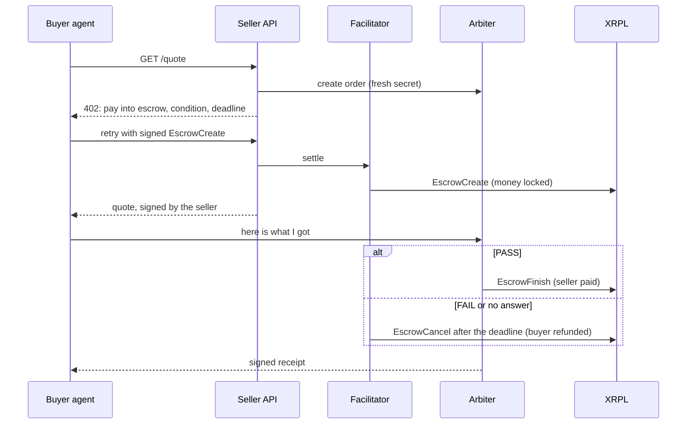

# x402 `auth-capture` on XRPL

Verify-then-pay for AI agents on the XRP Ledger. The buyer's payment is locked in a native XRPL Escrow, an independent arbiter checks the delivery, and the arbiter releases the escrow on PASS. On FAIL, or if nobody acts, the escrow expires and the buyer takes the money back.

This repo is an XRPL network binding of the x402 [`auth-capture`](https://github.com/x402-foundation/x402/blob/main/specs/schemes/auth-capture/scheme_auth_capture.md) scheme, plus demo apps. It is our entry for the AI & Fintech XRPL Hackathon (New York, Oct 24-25, 2026), Agentic Finance track.

- **Spec:** [`specs/scheme_auth_capture_xrpl.md`](./specs/scheme_auth_capture_xrpl.md). It answers the scheme's 8 binding requirements.
- **Design and milestones:** [`AGENTS.md`](./AGENTS.md). **Decisions:** [`DECISIONS.md`](./DECISIONS.md). **Pitch:** [`docs/pitch.md`](./docs/pitch.md).

## How it works



Nothing is deployed on-ledger. The guarantees come from XRPL consensus:
- The escrow can pay only `payTo`, and only with the arbiter's secret, before the deadline.
- After the deadline, anyone can return it to the buyer.

The facilitator holds no keys and no funds.

## Packages and apps

| Path | What it is |
| --- | --- |
| `packages/auth-capture-xrpl` | The mechanism package for `@x402/core`: client, server and facilitator schemes, the Arbiter interface and HTTP client, signed receipts and deliveries, and lifecycle helpers including the `ReclaimWatcher`. |
| `apps/facilitator` | `/supported`, `/verify`, `/settle`, plus the watcher that refunds expired escrows. |
| `apps/arbiter-stub` | The Arbiter HTTP API. It holds the preimage and finishes on PASS. Misa's checks decide the verdict against the seller's Misa listing (`POST /x/{slug}/checks`, set `MISA_CHECKS_URL`); without it, a local stand-in runs the same body checks. |
| `apps/seller` | A paid `GET /quote`; `?mode=cheat` returns a bad quote. |
| `apps/buyer-agent` | Claude with one tool, `buy_quote`. |
| `apps/demo` | A live timeline with explorer links and honest/cheat buttons. |

## Run it

Requires Node 22+ and pnpm 10. Testnet only.

```bash
pnpm install
pnpm check                  # lint, typecheck, build, test
pnpm testnet:setup          # fund buyer, seller, arbiter, facilitator wallets; writes .env
```

Start the four services in separate terminals, then open http://localhost:4050:

```bash
pnpm demo
pnpm facilitator
pnpm arbiter
pnpm seller
```

The arbiter judges each quote against the seller's published response schema (`GET /openapi.json` on the seller). The order's terms only name the seller's Misa listing and action (`{ slug, operation_id }`), so nobody can swap the schema per order. Set `MISA_CHECKS_URL=https://api.trymisa.com` in `.env` to have Misa check against the schema it froze when the seller listed; leave it unset and the local stand-in reads the seller's `/openapi.json` itself.

Then run any of these:

```bash
pnpm testnet:e2e all        # honest + cheat end to end, balances checked to the drop (~4 min)
pnpm agent honest           # Claude buys a quote (needs ANTHROPIC_API_KEY)
pnpm agent cheat
pnpm testnet:raw-escrow     # M1: ledger-only proof of create/finish/cancel
pnpm testnet:settle-escrow  # M3/M4: a client-signed escrow through the facilitator
pnpm testnet:reclaim-expired  # cancel any of the buyer's escrows past their deadline
```

Wallet seeds live in `.env` (gitignored). Never commit or print them.

## License

Apache-2.0. See [`LICENSE`](./LICENSE) and [`NOTICE`](./NOTICE).
